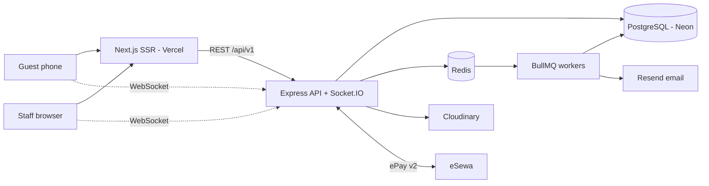
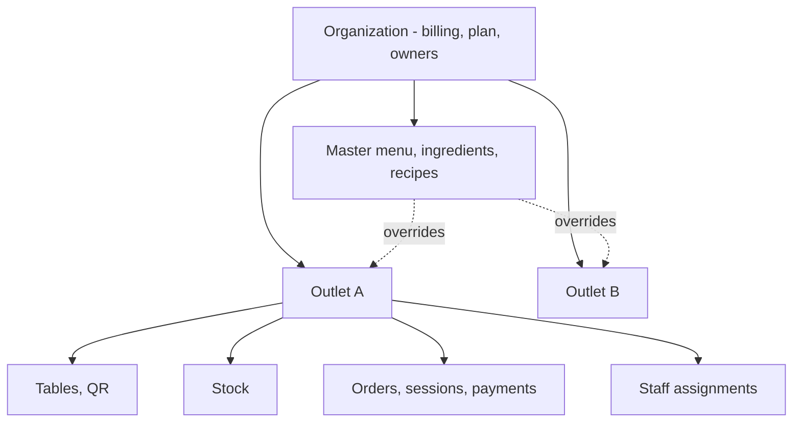
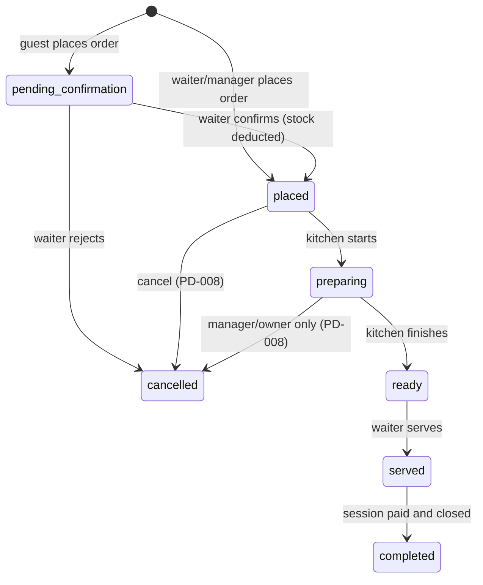
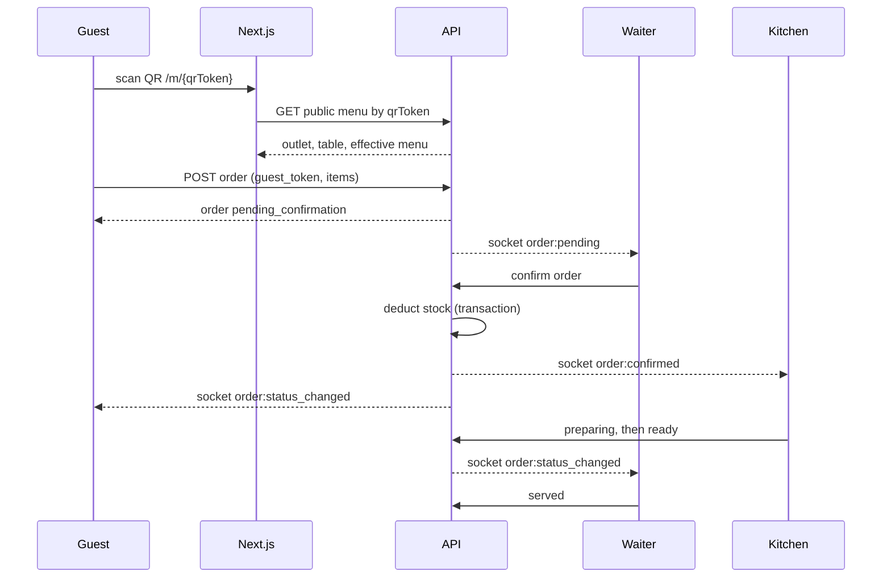
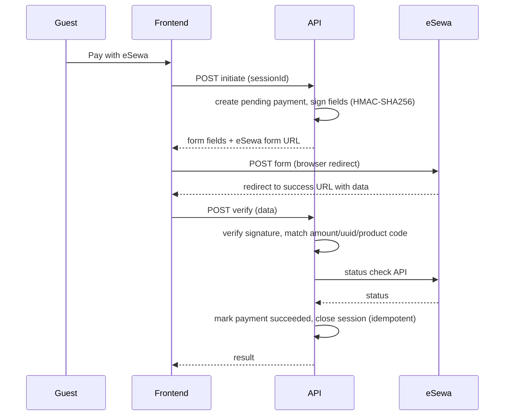

# ARCHITECTURE.md

Read with `TRD.md` (choices) and `CODING_STANDARDS.md` (folders).

---

## 1. System overview



- **Next.js** renders public pages (landing, pricing, guest menu) on the server for SEO and speed, and serves the staff dashboard.
- **Express API** is the only backend and the single source of business logic.
- **Socket.IO** runs inside the Express process. Redis is used so it can scale to multiple instances later (adapter decision when needed; ask the user).
- **Workers** run BullMQ jobs, in the same codebase and a separate process.

---

## 2. Backend request lifecycle

```
Request
 → requestId + logger
 → helmet, cors, cookie parser, body limit
 → rate limit
 → route match
 → auth (verify access token)
 → subscriptionGuard (trial/grace/suspended rules)
 → outletContext (X-Outlet-Id, verify assignment)
 → permission (can user do X at this outlet)
 → validate (Zod: params, query, body)
 → controller → service → model (Prisma)
 → response helper
 → errorHandler (any thrown AppError)
```

Public guest routes skip `auth` and `outletContext`; they use `qrToken` or `guest_token` and stricter rate limits.

---

## 3. Multi-tenant model



- Staff assignment = user + outlet + role. Owner has `outlet_id = NULL`.
- Outlet context is resolved in one middleware. Everything downstream only reads `req.outlet`.
- Plan gating: `multi_outlet_enabled` shows the switcher and "Add outlet"; `max_outlets` is enforced server-side.

---

## 4. Order lifecycle (state machine)



- Guest orders **always** enter `pending_confirmation`. Waiter-placed orders go straight to `placed`.
- Stock is deducted at the moment of `placed` (confirmation).
- Item statuses (`order_items.status`) follow the same flow; order status derivation is PD-009.
- Allowed transitions are defined in one place (`services/order/orderTransitions.ts`) and tested.

### Table session lifecycle

`open` → `bill_requested` → `closed`. Only one non-closed session per table. Closing sets the table to `free` and completes the orders.

---

## 5. Stock deduction (critical path)

Runs inside **one transaction**:

```
BEGIN
 1. Load order items and their recipes
 2. Sum required quantity per ingredient
 3. SELECT ... FOR UPDATE on the outlet_stock rows (ordered by ingredient id, avoids deadlocks)
 4. If any quantity would go below zero → ROLLBACK, return 422 (item unavailable)
 5. UPDATE outlet_stock quantities
 6. INSERT stock_movements (type order_deduction, balance_after, order_id)
 7. Mark menu items auto_unavailable where an ingredient hit zero
COMMIT
AFTER COMMIT: emit socket events, enqueue low-stock alert job
```

Restore on cancel mirrors this with `order_restore` movements. The DB `CHECK (quantity >= 0)` is the last safety net.

---

## 6. Guest ordering sequence



---

## 7. eSewa payment sequence



If the status check fails or times out, the payment stays `pending` and the `esewa-reconcile` job retries.

---

## 8. Frontend architecture

- App Router with route groups: `(public)`, `(auth)`, `(dashboard)`, `(admin)`.
- Public pages: Server Components, SSR, metadata for SEO.
- Dashboard: Client Components where interactive, TanStack Query for server data, Zustand for auth/outlet/UI state, Socket.IO client provider for live events.
- Route protection: Next.js `middleware.ts` redirects unauthenticated users; the API is still the real guard.
- Active outlet is kept in Zustand and sent as `X-Outlet-Id` by the API client.
- Sidebar items render from the user's permissions.

---

## 9. Jobs and scheduling

See `TRD.md` section 7. Workers share models and services with the API; they never duplicate business logic.

---

## 10. Error and failure handling

- Services throw `AppError`; the global handler maps to the error envelope.
- DB constraint violations are mapped to 409 or 422 with safe messages.
- External calls (eSewa, Resend, Cloudinary) use timeouts and bounded retries; failures never leave half-written state.
- Socket emit failures never fail the HTTP request.

---

## 11. Deployment topology

```
Vercel (Next.js) ──HTTPS──▶ Render/Railway (Express API + Socket.IO)
                              ├─ Neon Postgres
                              ├─ Managed Redis
                              └─ Worker process (BullMQ)
```

Frontend and API should share a parent domain in production so cookies work (see PD-004).
