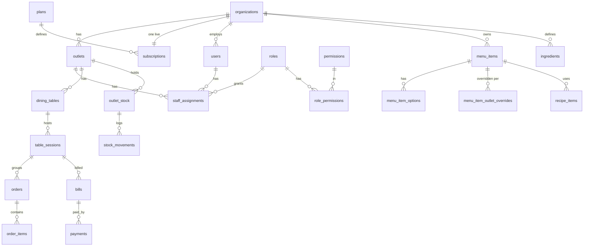

# DATABASE.md

Database: PostgreSQL. ORM: Prisma. Base schema reference: `docs/restaurant_saas_schema.sql`.
This document explains the schema and lists **additions required** on top of the base SQL. The agent updates this file whenever the schema changes.

---

## 1. Principles

1. Every operational table has `outlet_id`; org-level tables have `organization_id`.
2. UUID primary keys.
3. Money is `NUMERIC(10,2)`. Quantities are `NUMERIC(14,3)`.
4. Timestamps are `TIMESTAMPTZ` in UTC.
5. Orders snapshot item name, price and options so history never changes.
6. Stock changes are append-only in `stock_movements`.
7. Constraints in the DB protect important rules (no negative stock, one open session per table, one live subscription per org).
8. Soft delete (`deleted_at`) for organizations, outlets and menu items. Hard delete only for child rows via cascade.

---

## 2. Table groups

| Group | Tables |
|---|---|
| Billing and tenancy | `plans`, `organizations`, `subscriptions`, `custom_plan_leads` |
| Locations | `outlets` |
| Auth and access | `users`, `roles`, `permissions`, `role_permissions`, `staff_assignments`, `invitations`, `refresh_tokens` |
| Menu | `menu_categories`, `menu_items`, `menu_item_options`, `menu_item_outlet_overrides` |
| Dining floor | `dining_tables`, `table_sessions` |
| Orders | `orders`, `order_items` |
| Payments | `bills`, `payments`, `webhook_events` |
| Inventory | `ingredients`, `recipe_items`, `outlet_stock`, `stock_movements` |
| System | `notifications`, `audit_logs` |

### Relationships (summary)



---

## 3. Notes per area

- **Plans and subscriptions:** `plans` holds default limits and feature flags. `subscriptions` holds status, trial and grace dates, and `*_override` columns so Custom plans are just data. Effective limit = override if set, otherwise plan value.
- **Roles:** `staff_assignments` = user + outlet + role. Owner: `outlet_id IS NULL`. Waiter and Kitchen single-outlet is enforced in the service layer (not the DB), because Manager may have several.
- **Menu:** master items at org level; `menu_item_outlet_overrides` gives per-outlet price and availability. `auto_unavailable` is set by inventory; `is_available` is the manual toggle. An item is orderable only if both allow it.
- **Sessions:** partial unique index guarantees one non-closed session per table.
- **Orders:** `CHECK` requires a session for dine-in orders. `order_number` is per outlet per day (PD-020). `confirmed_at` marks stock deduction time.
- **Payments:** `idempotency_key` and `webhook_events` guard against duplicates. For eSewa, the unique `transaction_uuid` (added below) ties the callback to the right payment.
- **Inventory:** `outlet_stock.quantity CHECK (>= 0)` is the oversell guard. Deduction uses `SELECT … FOR UPDATE`.

---

## 4. Required additions (migration 002)

The base SQL does not cover everything the PRD and TRD need. These were applied as migration `20261110120100_additions` on 2026-11-10; the base schema is migration `20261110120000_init`. Ask the user before changing them.

```sql
-- Remember last active outlet for Owner/Manager
ALTER TABLE users ADD COLUMN last_outlet_id UUID REFERENCES outlets(id) ON DELETE SET NULL;

-- Refresh-token rotation and reuse detection
ALTER TABLE refresh_tokens
  ADD COLUMN family_id UUID NOT NULL DEFAULT gen_random_uuid(),
  ADD COLUMN used_at TIMESTAMPTZ,
  ADD COLUMN replaced_by UUID REFERENCES refresh_tokens(id);
CREATE INDEX idx_refresh_family ON refresh_tokens(family_id);

-- Email verification and password reset
ALTER TABLE users ADD COLUMN email_verified_at TIMESTAMPTZ;

CREATE TABLE auth_tokens (
    id          UUID PRIMARY KEY DEFAULT gen_random_uuid(),
    user_id     UUID NOT NULL REFERENCES users(id) ON DELETE CASCADE,
    purpose     TEXT NOT NULL CHECK (purpose IN ('verify_email','reset_password')),
    token_hash  TEXT NOT NULL,
    expires_at  TIMESTAMPTZ NOT NULL,
    used_at     TIMESTAMPTZ,
    created_at  TIMESTAMPTZ NOT NULL DEFAULT now()
);
CREATE INDEX idx_auth_tokens_user ON auth_tokens(user_id, purpose);

-- Waiter confirmation of guest orders
ALTER TABLE orders
  ADD COLUMN confirmed_by UUID REFERENCES users(id),
  ADD COLUMN rejected_by UUID REFERENCES users(id),
  ADD COLUMN idempotency_key TEXT,                    -- PD-019
  ADD COLUMN business_date DATE NOT NULL DEFAULT CURRENT_DATE;  -- set by app in the outlet timezone
CREATE UNIQUE INDEX uq_orders_idem ON orders(outlet_id, idempotency_key) WHERE idempotency_key IS NOT NULL;
CREATE UNIQUE INDEX uq_orders_number_per_day ON orders(outlet_id, business_date, order_number);  -- PD-020

-- eSewa credentials per outlet, encrypted (PD-011, PD-012)
CREATE TABLE outlet_payment_settings (
    outlet_id             UUID PRIMARY KEY REFERENCES outlets(id) ON DELETE CASCADE,
    provider              TEXT NOT NULL DEFAULT 'esewa',
    product_code          TEXT NOT NULL,
    secret_key_encrypted  TEXT NOT NULL,              -- AES-256-GCM payload (iv + tag + ciphertext)
    is_test_mode          BOOLEAN NOT NULL DEFAULT TRUE,
    is_enabled            BOOLEAN NOT NULL DEFAULT FALSE,
    updated_at            TIMESTAMPTZ NOT NULL DEFAULT now()
);

-- eSewa transaction tracking on payments
ALTER TABLE payments
  ADD COLUMN transaction_uuid TEXT UNIQUE,
  ADD COLUMN raw_callback JSONB,
  ADD COLUMN verified_at TIMESTAMPTZ;

-- Manual SaaS subscription payments (PD-013)
CREATE TABLE subscription_payments (
    id               UUID PRIMARY KEY DEFAULT gen_random_uuid(),
    organization_id  UUID NOT NULL REFERENCES organizations(id) ON DELETE CASCADE,
    subscription_id  UUID NOT NULL REFERENCES subscriptions(id),
    amount           NUMERIC(10,2) NOT NULL CHECK (amount > 0),
    reference        TEXT NOT NULL,                   -- eSewa or bank transaction reference
    status           TEXT NOT NULL DEFAULT 'submitted' CHECK (status IN ('submitted','approved','rejected')),
    period_months    INT NOT NULL DEFAULT 1,
    reviewed_by      UUID REFERENCES users(id),
    reviewed_at      TIMESTAMPTZ,
    created_at       TIMESTAMPTZ NOT NULL DEFAULT now()
);

-- Cancelled bills keep their invoice number (D-046)
CREATE TYPE bill_status AS ENUM ('open','paid','cancelled');
ALTER TABLE bills
  ADD COLUMN status bill_status NOT NULL DEFAULT 'open',
  ADD COLUMN cancelled_at TIMESTAMPTZ,
  ADD COLUMN cancelled_by UUID REFERENCES users(id),
  ADD COLUMN cancel_reason TEXT;
```

> Prisma cannot express partial unique indexes or CHECK constraints. Put these in raw SQL inside Prisma migration files (PD-017) and keep `schema.prisma` in sync for the columns and relations.

---

## 5. Indexing checklist

- `orders (outlet_id, status, created_at DESC)` — kitchen and waiter boards
- `orders (outlet_id, created_at)` — analytics
- `order_items (outlet_id, menu_item_id)` — top sellers
- `table_sessions (outlet_id, status)`
- `stock_movements (outlet_id, ingredient_id, created_at DESC)`
- `staff_assignments (outlet_id)` and unique `(user_id, outlet_id)`
- `payments (bill_id)`, unique `transaction_uuid`, unique `idempotency_key`
- Add more only when a query needs it; justify in this file.

---

## 6. Seed data

Seed script: `backend/prisma/seed.ts`, run with `npm run db:seed`. It is idempotent and creates the roles, permissions, role-permission mappings (PRD matrix) and the three plans (Trial, Single, Custom). The Super Admin seed belongs to task SA-001; the demo organization with outlets, tables, menu, ingredients, recipes and sample staff is part of the demo/portfolio deliverable, not this seed.

## 7. Rules for changing the schema

1. Ask the user before any new table, column or constraint not listed here.
2. Create a migration; never edit applied migrations.
3. Update this file, `TASK.md`, and the Prisma schema in the same task.
4. Add or update tests that cover the change.

## 8. Change log

| Date | Change |
|---|---|
| 2026-11-05 | Initial schema plus migration 002 additions documented |
| 2026-11-10 | Base schema SQL `docs/restaurant_saas_schema.sql` added by the user; checked against this document (see T-001 report for the items to resolve in T-006) |
| 2026-11-10 | Migrations `20261110120000_init` (base) and `20261110120100_additions` (section 4) applied. NPR currency defaults and `price_monthly = 0` placeholders (D-043), outlet `tax_percent = 13.00` / `service_charge_percent = 10.00` (D-044), bill `status` plus cancellation fields (D-046). Prisma schema synced; `migrate diff` is empty |
| 2026-11-10 | T-007 seed applied: roles, permissions, PRD matrix (Waiter includes `order.cancel`, D-045) and three plans. Section 6 scope corrected: Super Admin is SA-001, demo data is a later deliverable |
